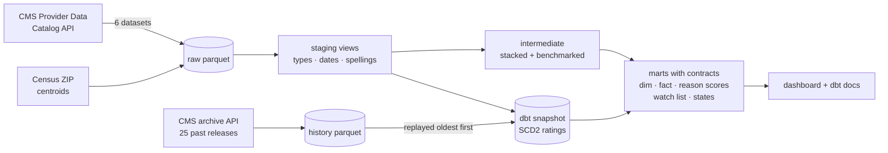

# Hospital Quality Warehouse


**Live: [hospital chooser](https://madhubuddaraju.github.io/hospital-quality-warehouse/) ·
[dbt docs and lineage graph](https://madhubuddaraju.github.io/hospital-quality-warehouse/lineage.html)**

## The problem

Someone choosing where to have surgery, or where to take a parent with chest pain, can't easily compare hospitals.
Medicare publishes the data, but it is split across separate datasets with different layouts, numbers stored as
text, "Not Available" in place of blanks, and six different spellings of "better or worse than the national rate".
Ratings change every quarter and nobody keeps the history.

## What this does

- **Hospital chooser.** Enter a ZIP code and a reason for care (heart attack, hip or knee replacement, an ER visit,
  stroke...). Nearby hospitals are ranked on the measures that matter for that reason, each compared with every
  other US hospital, with Medicare's own better/worse judgement shown measure by measure.
- **Watch list.** Hospitals Medicare rates significantly worse than the national rate on two or more patient
  outcomes, or whose star rating fell sharply during the past year (two stars or more, or down to one star).
- **Rating history since 2021.** Every past Medicare release replayed through a dbt snapshot, so each hospital's
  rating has a full Type 2 history dated by release.

__RESULTS__

## How it's built



**Dagster** orchestrates it as software-defined assets: ingestion (one asset per raw dataset), the history replay,
every dbt model (via dagster-dbt, so each dbt test is a Dagster asset check), and the published pages. A failed
check stops the run before a bad release reaches the page. A GitHub Action runs the whole graph every Monday.

**dbt** (on DuckDB) does the modelling:

| Layer | Models | What happens there |
|---|---|---|
| staging | `stg_cms__hospitals`, `stg_cms__outcome_measures`, `stg_cms__timely_care`, `stg_cms__patient_survey`, `stg_cms__infections`, `stg_census__zip_centroids` | text to numbers, US dates to dates, "Not Available" to null, six comparison spellings to five values |
| intermediate | `int_measures__unioned`, `int_measures__benchmarked` | 30 measures from four datasets in one table; each hospital's national percentile, direction-aware |
| marts | `dim_hospitals`, `fct_hospital_measures`, `mart_hospital_reason_scores`, `mart_watch_list`, `mart_state_summary`, `mart_rating_history` | what the dashboard reads; `dim_hospitals` and `mart_hospital_reason_scores` have enforced contracts |
| snapshot | `hospital_rating_snapshot` | check strategy on rating, name, type, ownership and ER status, with `updated_at` = release date |
| seeds | `measure_catalog`, `care_reasons` | plain-English labels, domains, direction, and which reasons each measure informs |

## Engineering decisions

**Replaying history through a snapshot.** A dbt snapshot normally only sees the day it runs. CMS keeps an archive of
every past release, so the pipeline feeds those releases through the snapshot oldest first, setting `updated_at` to
each release date. The result is a real Type 2 dimension back to January 2021 instead of one that starts today.
The snapshot table is exported to parquet in the repo after each run, so history survives between ephemeral CI
runners, and `releases.json` records which releases have been replayed so each run only adds new ones.

**Schema drift across five years of files.** Older releases lack columns added later (such as the birthing-friendly
designation). Each release is aligned to the current layout before replay, so staging never breaks on old files.

**Reading one file out of a large zip.** Archive zips are read with HTTP range requests (remotezip), transferring only
the one CSV needed from each, with a fallback to a full download if the server doesn't support ranges.

**Tests that caught real things.** The latitude test originally assumed every hospital is north of 13°N. The first
national run failed it: American Samoa, south of the equator, has a Medicare hospital. The test was wrong, not the
data. The ZIP coverage test found that PO-box ZIP codes (such as downtown Providence's 02902) have no Census area;
those hospitals are now placed at the nearest ZIP code in the same three-digit area, and `location_source` says so.

**dbt unit tests for the logic that matters.** One checks that every CMS spelling of a comparison maps to the right
value, one that a lower-is-better measure ranks the lowest score best (and the opposite for higher-is-better), and one
that reason scores weight hospital-wide measures at half.

**One writer at a time.** DuckDB allows a single writer, so Dagster runs this graph with the in-process executor.

## Run it

```bash
git clone https://github.com/madhubuddaraju/hospital-quality-warehouse.git
cd hospital-quality-warehouse
python -m venv .venv && source .venv/bin/activate
make install
make sample     # whole pipeline on a committed real-data sample (three states), no downloads
make live       # current CMS release + every past release, about 10 minutes
make ui         # Dagster UI with the asset graph: http://localhost:3000
```

## Project structure

```
scripts/fetch_cms.py        CMS catalog API, archive API (range reads), Census gazetteer
scripts/use_fixtures.py     loads the committed sample for CI and local runs
hospital_quality/
  definitions.py            Dagster assets, asset checks, snapshot replay, schedule
  web.py                    exports the marts to the dashboard
dbt/
  models/staging            one view per source
  models/intermediate       stacked and benchmarked measures
  models/marts              dashboard tables, contracts, tests, unit tests
  snapshots/                rating history (SCD2)
  seeds/                    measure catalog, care reasons
  macros/                   CMS parsing helpers and custom generic tests
dashboard/template.html     the hospital chooser
data/snapshots/             snapshot history kept between runs
tests/fixtures/             real CMS rows for 43 hospitals in RI, DE and VT
```

## Data and limitations

[CMS Provider Data Catalog](https://data.cms.gov/provider-data/topics/hospitals) (Hospital General Information,
Unplanned Hospital Visits, Complications and Deaths, Timely and Effective Care, HCAHPS patient survey,
Healthcare-Associated Infections) and the [Census Bureau gazetteer](https://www.census.gov/geographies/reference-files/time-series/geo/gazetteer-files.html).
Public domain.

- Measures cover different periods (some span three years) and Medicare patients mainly.
- Percentile ranks treat small differences as meaningful; Medicare's own better/worse judgement, shown alongside,
  accounts for statistical uncertainty.
- Distances use ZIP code centres, not street addresses.
- This compares published quality measures. It is not medical advice.

## License

MIT
